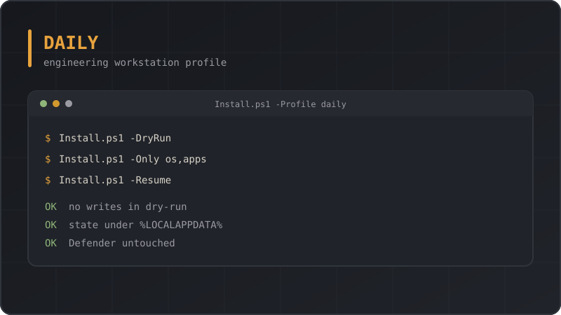
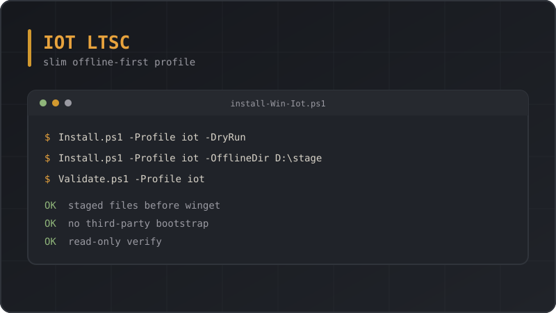

# win11-engineering-stack

installs two Windows setups with native PowerShell 5.1. the daily profile builds an engineering workstation. the iot profile builds a slim Windows 10 or 11 IoT Enterprise LTSC image.

[read the quickstart](QUICKSTART.md)

| | |
| --- | --- |
| **profiles** | `daily` installs development tools, Git and gh config, MATLAB paths, OmniRoute, VSCodium, Windows Terminal and per-app configs. `iot` installs a smaller LTSC app set from staged files, winget or vendor URLs. |
| **dry run** | `-DryRun` prints the writes and installs it would perform. it does not change settings, install apps or overwrite configs. logs and the IoT report are still written. |
| **configs** | one `config/` tree serves both profiles. IoT keeps `defaults.json` and an empty `hashes.json`, so downloads are not hash-pinned today. |
| **guardrails** | Defender preferences are not written. `OMNIROUTE_API_KEY` is read from the environment only. one default debloat pass runs unless `-NoDebloat` is set; there are no safe/standard/aggressive tiers and no third-party package manager bootstrap. |

## Preview

| Daily | IoT LTSC |
| --- | --- |
|  |  |

## Run it

Run PowerShell from the repo root. The script asks for elevation when a step
needs it.

```powershell
.\Install.ps1 -Profile daily -DryRun
.\Install.ps1 -Profile daily
```

```powershell
.\Install.ps1 -Profile iot -DryRun
.\Install.ps1 -Profile iot
```

`Setup.cmd` starts the IoT profile through `Install.ps1` and passes extra flags through. It is the
post-install path for tiny11, AspectOS, and Windows 11 IoT Enterprise LTSC images. Missing winget,
AppX, Store, or scheduled-task cmdlets are skips, not hard failures. For filters, resume, and the
full flag list, read [CLI contract](docs/CLI.md).

## Verify

```powershell
.\Validate.ps1 -Profile daily
.\Validate.ps1 -Profile iot
```

Exit 0 means the checked state is present. Exit 1 means at least one real check
failed. Both paths only read system state. Neither writes a log, transcript, or
report. `Install.ps1 -Verify` is an alias for the matching `Validate.ps1` call.

Daily state is read-only with `.\Install.ps1 -Status`. It prints completed
modules, pending reboot, and the next command.

## What the modules do

The daily profile runs steps in this order:

```text
preflight os packages apps engineering developer omniroute theme configs debloat validate
```

Run one step with `-Only`:

```powershell
.\scripts\Install.ps1 -Only os -SxsPath D:\sources\sxs
.\scripts\Install.ps1 -Only engineering -TiaInstaller D:\TIA\Start.exe -MatlabInstaller D:\MATLAB\setup.exe
.\scripts\Install.ps1 -Resume
```

The IoT profile uses app ID patterns for `-Only` and `-SkipApps`. It does not
use module names. See [CLI contract](docs/CLI.md).

## Behavior

- Daily state lives in `%LOCALAPPDATA%\win11-stack`. IoT state lives beside its
  logs under `C:\Windows\Logs\Win-Iot-Setup`, with a `%TEMP%` fallback.
- Daily logs go to `%LOCALAPPDATA%\win11-stack\logs`. IoT logs go to
  `C:\Windows\Logs\Win-Iot-Setup`.
- If winget is missing on daily, app installs are skipped with the IDs to
  install by hand. On IoT, apps with a GitHub or direct source still install.
- IoT package sources are staged files, then winget, then GitHub releases or
  direct vendor URLs.
- The default debloat pass removes the consumer app set and applies UI/privacy
  values. It never touches Windows Update, Defender, Store, Terminal, WebView2,
  or .NET. Use `-NoDebloat` only for recovery or a deliberate stock image.
- A reboot is required after OS feature changes. Re-run with `-Resume`.

## Theme

Editors and terminals use Graphite Amber. Windows stays light, and engineering
apps keep their native light theme. See the
[visual standard](https://github.com/SOSMLG/.github/blob/main/docs/THEME.md) or
[الطابع البصري](https://github.com/SOSMLG/.github/blob/main/docs/THEME.ar.md).

## Desktop apps

See the [app inventory](docs/APPS.md) for install IDs, config paths, and manual steps.

- 7-Zip is in both app lists. The IoT self-check also accepts the Program Files install path.
- qBittorrent ships with WebUI off, UPnP off, no stored web password, and loopback only if WebUI is enabled locally. Existing configs are kept.
- LibreWolf is the IoT browser. It gets three isolated profiles, Start Menu shortcuts, and safe `defaultPref` overrides. Default browser is a manual Settings step.
- Joplin replaces Obsidian and gets a light, local-only seed config. Spotube replaces Spotify; its one-time first-run setup is left to the app.
- Outlook for Windows is removed and blocked from reinstalling by the default debloat pass. Classic Outlook from a paid Office install is not touched.
- Mem Reduct ships in the default install; `-Minimal` skips it. No autostart, no scheduled cleanup, native light UI.
- Windows Terminal keeps one Graphite Amber scheme and no stale PowerShell 7 profile.

## OmniRoute and OpenCode

OmniRoute listens on `127.0.0.1:20128`. Set `OMNIROUTE_API_KEY` as a user
environment variable. The installer never writes the key to a file. OpenCode
uses the V2 `providers` shape in `config/opencode/opencode.json`.

The logon task uses a `.cmd` wrapper because `omniroute` can resolve to a `.cmd`
shim on Windows.

## Repo layout

| Path | What is there |
| --- | --- |
| `Install.ps1`, `Validate.ps1` | Front doors for both profiles |
| `QUICKSTART.md` | Shortest safe run and verify path |
| `scripts/` | Daily modules, shared helpers, read-only validator |
| `config/` | Shared config tree and IoT defaults |
| `docs/` | Runbook, audit, research, OpenCode and CLI notes |
| `assets/` | Banner and profile previews |
| `ventoy/` | Ventoy answer files |
| App folders | Per-app config and notes |
| `tools/` | Local token audit helper |

## Docs

- [Quickstart](QUICKSTART.md)
- [CLI contract](docs/CLI.md)
- [Runbook](docs/RUNBOOK.md)
- [OpenCode notes](docs/OPENCODE.md)
- [Audit](docs/AUDIT.md)
- [Research](docs/RESEARCH.md)
- [Contributing](CONTRIBUTING.md)
- [Security](SECURITY.md)
- [Third-party notices](THIRD-PARTY-NOTICES.md)

## License

MIT. See [LICENSE](LICENSE).

## More from SOSMLG

- [DebianSway](https://github.com/SOSMLG/DebianSway): Sway on Debian and Devuan
- [DevuanDwm](https://github.com/SOSMLG/DevuanDwm): dwm on Devuan
- [XfceMlg](https://github.com/SOSMLG/XfceMlg): Xfce setup for Debian and Devuan
- [All repos](https://github.com/SOSMLG)

Bugs and ideas go in [issues](https://github.com/SOSMLG/win11-engineering-stack/issues).

## Repository standard

This repo follows the SOSMLG standard: [contributing](CONTRIBUTING.md), [security](SECURITY.md), [changelog](CHANGELOG.md). Local workflow: [English guide](https://github.com/SOSMLG/.github/blob/main/docs/GIT_GUIDE.md) / [Arabic guide](https://github.com/SOSMLG/.github/blob/main/docs/GIT_GUIDE.ar.md). Visual standard: [theme](https://github.com/SOSMLG/.github/blob/main/docs/THEME.md) / [الطابع البصري](https://github.com/SOSMLG/.github/blob/main/docs/THEME.ar.md).
