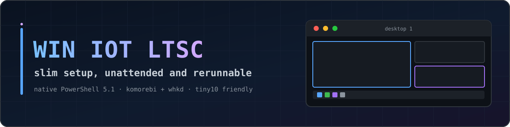

<div align="center">
  
</div>

<div align="center">

# win11-engineering-stack

one Windows setup repo, two profiles. `daily` is an engineering workstation.
`iot` is a slim Win10/Win11 IoT Enterprise LTSC build. native PowerShell 5.1,
one config tree, dry-run before every write.


</div>

> this changes system settings. run `-DryRun` first, then read the
> [quickstart](QUICKSTART.md) and [runbook](docs/RUNBOOK.md). try it in a VM
> before a real machine.

<div align="center">
  
  
</div>

## quick start

```powershell
.\Install.ps1 -Profile daily -DryRun
.\Install.ps1 -Profile daily

.\Install.ps1 -Profile iot -DryRun
.\Install.ps1 -Profile iot
```

`Setup.cmd` still starts the old one-click IoT path and passes extra flags
through. read [QUICKSTART.md](QUICKSTART.md) for filters, resume, and the full
verify commands.

## what you get

- one front door for both profiles: `Install.ps1`
- one read-only validator: `Validate.ps1`
- modular daily steps: preflight, OS, packages, apps, engineering, developer,
  OmniRoute, theme, configs, validate
- offline-first IoT installs: staged files, then winget, then pinned vendor URLs
- one shared `config/` tree, with IoT defaults kept separate
- Graphite Amber for editors and terminals, native light for engineering apps
- no tweak pack, no debloat pass, no Defender preference writes

## profiles

| profile | entry point | what it does |
| --- | --- | --- |
| `daily` | `scripts/Install.ps1` | OS features, winget apps, MATLAB path, TIA detection, VSCodium, Git/gh, developer accounts, OmniRoute, theme, configs |
| `iot` | `install-Win-Iot.ps1` | unattended slim LTSC build, offline-first engines, stock desktop, per-app configs |

both profiles share `config/`. the daily profile uses the modular files under
`config/opencode`, `config/vscodium`, `config/vesktop`, and `config/vencord`.
the IoT profile keeps its own `config/defaults.json` and `config/hashes.json`.
`hashes.json` is empty today, so downloads are not pinned. imported reference
copies from the old daily repo live under `config/daily/` and are read-only
reference material.

## verify

```powershell
.\Validate.ps1 -Profile daily
.\Validate.ps1 -Profile iot
```

or call a profile directly:

```powershell
.\scripts\Validate.ps1
.\install-Win-Iot.ps1 -Verify
```

these paths only read state. exit 1 means at least one real check failed.

## behavior

- **dry-run is safe for system state.** no settings, installs, or config files
  change. logs and a report are still written.
- **idempotent.** state lives in `%LOCALAPPDATA%\win11-stack` for daily runs and
  next to the log for IoT runs. `-Force` reruns skipped work.
- **logs.** daily logs land in `%LOCALAPPDATA%\win11-stack\logs`. IoT logs land
  in `C:\Windows\Logs\Win-Iot-Setup`, with a fallback to `%TEMP%` when not
  elevated.
- **winget missing.** the daily profile prints a skip and leaves apps alone.
  install App Installer, then install by hand with these IDs:
  `VSCodium.VSCodium`, `Git.Git`, `GitHub.cli`, `OpenJS.NodeJS.LTS`,
  `Python.Python.3.12`, `7zip.7zip`, `Microsoft.VCRedist.2015+.x64`,
  `Microsoft.VCRedist.2015+.x86`, `Microsoft.EdgeWebView2Runtime`,
  `Microsoft.PowerToys`, `KeePassXCTeam.KeePassXC`, `LibreWolf.LibreWolf`,
  `ONLYOFFICE.DesktopEditors`, `Vencord.Vesktop`, `Microsoft.WindowsTerminal`,
  `DEVCOM.JetBrainsMonoNerdFont`.
- **IoT package sources.** staged files first, then winget, then GitHub releases or
  direct vendor URLs. no third-party package manager is bootstrapped.
- **Defender.** stays as shipped. no script writes its preferences or disables
  real-time protection.

## IoT flags

the full list is in `install-Win-Iot.ps1 -?`. the ones used most:

| flag | what it does |
| --- | --- |
| `-DryRun` | print planned writes, downloads, and installs without applying them |
| `-Verify` | check repo configs and installed state, exit 1 if anything is missing |
| `-Unattended` | no prompts |
| `-ConfigsOnly` | re-copy user configs, nothing else |
| `-OfflineDir <path>` | install from staged files; winget is not required |
| `-NoWingetBootstrap` | skip App Installer bootstrap; staged and direct sources still apply |
| `-DriverDir <path>` | install drivers from a folder |
| `-Only`, `-SkipApps` | filter the app list |
| `-Fixes` | repair DNS, winsock, and the update stack |

## theme

the repo uses one Graphite Amber standard: graphite surfaces, warm gray text,
and one amber highlight per view. VSCodium and Windows Terminal use
`Graphite Amber`; engineering apps stay on their native light theme. see the
[visual standard](https://github.com/SOSMLG/.github/blob/main/docs/THEME.md) and
[الطابع البصري](https://github.com/SOSMLG/.github/blob/main/docs/THEME.ar.md).

## OmniRoute and OpenCode

OmniRoute listens on `127.0.0.1:20128`. create a tool key in its dashboard and
set `OMNIROUTE_API_KEY` as a user environment variable. the installer never
writes the key to a file. OpenCode uses the V2 `providers` shape from
`config/opencode/opencode.json`. deny rules live in `permissions`, and the
watcher ignore list lives in `watcher.ignore`.

the logon task uses a small `.cmd` wrapper under `%LOCALAPPDATA%\win11-stack\bin`
because `omniroute` can resolve to a `.cmd` shim on Windows.

## repo layout

| path | what |
| --- | --- |
| `Install.ps1`, `Validate.ps1` | one front door for both profiles |
| `QUICKSTART.md` | shortest safe path to run and verify |
| `scripts/` | daily modules, shared helpers, read-only validator |
| `config/` | shared config tree and IoT defaults |
| `docs/` | OpenCode notes, audit, research, runbook |
| `assets/` | banner and profile preview cards |
| `ventoy/` | answer files for Ventoy media |
| app folders | per-app config plus a short note |
| `tools/` | local token audit helper |

## docs

- [quickstart](QUICKSTART.md)
- [CLI contract](docs/CLI.md)
- [OPENCODE.md](docs/OPENCODE.md)
- [RUNBOOK.md](docs/RUNBOOK.md)
- [AUDIT.md](docs/AUDIT.md)
- [RESEARCH.md](docs/RESEARCH.md)
- [CONTRIBUTING.md](CONTRIBUTING.md)
- [SECURITY.md](SECURITY.md)
- [THIRD-PARTY-NOTICES.md](THIRD-PARTY-NOTICES.md)

## license

MIT. see [LICENSE](LICENSE).

## more from SOSMLG

- [DebianSway](https://github.com/SOSMLG/DebianSway) - sway/wayland desktop for Debian and Devuan
- [DevuanDwm](https://github.com/SOSMLG/DevuanDwm) - dwm-based minimal desktop for Devuan
- [XfceMlg](https://github.com/SOSMLG/XfceMlg) - XFCE setup for Debian and Devuan
- [profile and all repos](https://github.com/SOSMLG) - notes, configs, and the rest of the setups

bugs and ideas go in [issues](https://github.com/SOSMLG/win11-engineering-stack/issues).

## Repository standard

This repo follows the SOSMLG standard: [contributing](CONTRIBUTING.md), [security](SECURITY.md), [changelog](CHANGELOG.md). Local workflow: [English guide](https://github.com/SOSMLG/.github/blob/main/docs/GIT_GUIDE.md) / [Arabic guide](https://github.com/SOSMLG/.github/blob/main/docs/GIT_GUIDE.ar.md). Visual standard: [theme](https://github.com/SOSMLG/.github/blob/main/docs/THEME.md) / [الطابع البصري](https://github.com/SOSMLG/.github/blob/main/docs/THEME.ar.md).
